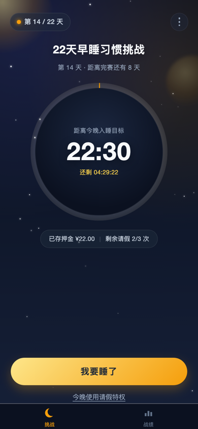
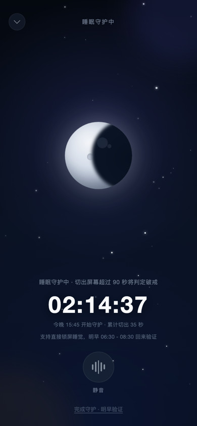
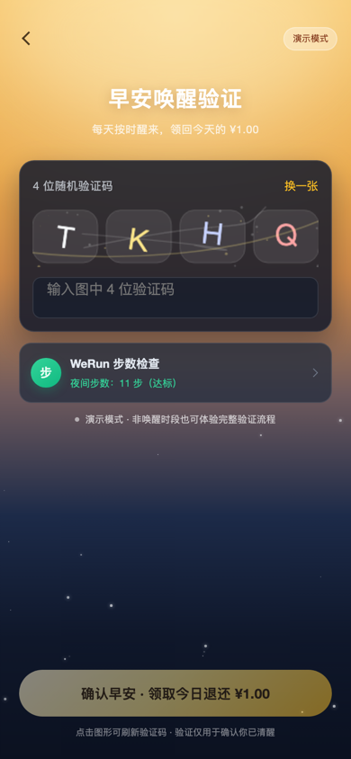
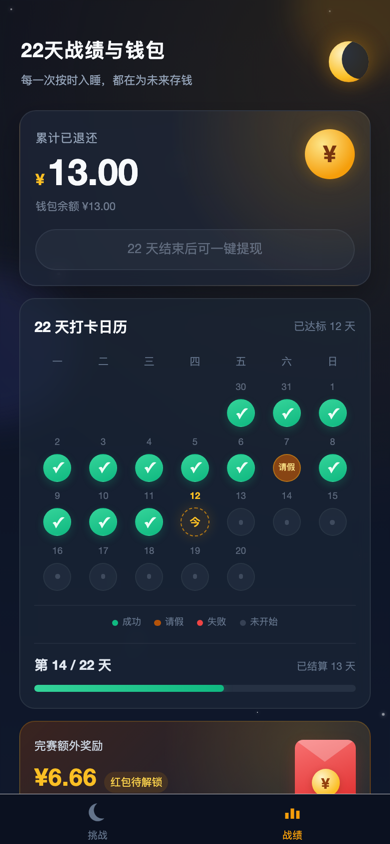

# 睡了么 · 22 天早睡习惯契约

> 用 22 元契约，赎回你的深度睡眠。

基于 **Taro 4.2 + Vue 3 + TypeScript + 微信云开发（CloudBase）** 的早睡自律小程序。
用户缴纳 ¥22 契约押金，进入 22 天挑战：每天按时进入睡眠守护、次日完成晨间唤醒验证，
即可拿回 ¥1.00；22 天内违约不超过 3 次，还能额外解锁 ¥6.66 完赛红包。

<table>
  <tr>
    <td align="center"><br/><b>挑战看板</b></td>
    <td align="center"><br/><b>睡眠守护</b></td>
    <td align="center"><br/><b>早安验证</b></td>
    <td align="center"><br/><b>战绩与钱包</b></td>
  </tr>
</table>

## 特性

- **22 天契约状态机**：入睡守护 → 待唤醒 → 成功 / 请假 / 违约，22 天结束自动完赛结算。
- **三重防作弊**：小程序切屏 90 秒监控、微信运动夜间步数交叉校验、Canvas 4 位图形验证码。
- **3 次免死金牌**：主动请假或首次违约自动抵扣，请假当天照常退还 ¥1.00。
- **资金看板**：每日退还、钱包余额、请假次数、完赛红包资格实时可视化。
- **零配置预览**：未开通云开发时自动使用本地演示数据，微信开发者工具打开即可跑通全部流程。
- **云端模式**：所有涉及押金 / 请假 / 打卡状态的写操作都在云函数内完成，客户端无法直接改库。

## 快速开始

```bash
yarn install
yarn dev:weapp
```

1. 打开微信开发者工具，导入项目根目录（`project.config.json` 已配置 `miniprogramRoot: ./dist`）。
2. 填写自己的小程序 AppID（当前配置里是示例 AppID）。
3. 编译后即可预览。**默认就是演示模式**：
   - 自动生成“第 14 / 22 天”的演示进度；
   - 微信运动步数用本地模拟值；
   - 请假、入睡、晨间验证、提现全部可体验；
   - 首页右上角「⋮」→「重置演示数据」可恢复初始进度；
   - 「体验报名流程」会清空演示进度，回到未报名状态，方便走查报名 → 第 1 天 → 验证的完整流程。

> 演示模式下打开晨间验证：在睡眠守护页点「完成守护 · 明早验证」，
> 弹窗选择「去体验」即可直接进入验证页（正式环境只能在次日 06:30 - 08:30 验证）。

## 目录结构

```text
.
├── config/                     # Taro 构建配置（alias / 静态资源 copy）
├── cloudfunctions/             # 微信云函数
│   ├── challenge/              # 契约核心业务：snapshot / enroll / startSleep / verifyWakeup ...
│   ├── decryptWeRun/           # 微信运动 CloudID 解密
│   ├── pushWakeupNotice/       # 06:30 晨间订阅消息（含定时触发器）
│   └── dailyAutoSettle/        # 08:35 自动结算（含定时触发器）
├── docs/screenshots/           # README 截图
├── src/
│   ├── components/             # StarField / ProgressRing / Captcha / NavBar
│   ├── constants/              # 契约参数、状态、存储 key
│   ├── pages/
│   │   ├── index/              # Tab1 挑战看板
│   │   ├── wallet/             # Tab2 22 天战绩与钱包
│   │   ├── sleep/              # 睡眠守护全屏页
│   │   ├── wake/               # 晨间唤醒验证
│   │   └── enroll/             # 内测报名 / 押金说明
│   ├── services/               # mock / cloud 数据层、微信能力封装、切屏守护
│   ├── store/                  # 全局状态、派生数据、动作
│   ├── types/                  # 领域类型
│   └── utils/                  # 日期、系统信息
├── project.config.json         # miniprogramRoot + cloudfunctionRoot
└── package.json
```

## 数据模式

| 模式 | 触发条件 | 数据位置 | 适用场景 |
| --- | --- | --- | --- |
| 本地演示 | `TARO_APP_CLOUD_ENV` 为空 | 本机 Storage | UI 走查、流程联调、评审 |
| 微信云开发 | 构建环境变量非空，且构建平台为 `weapp` | CloudBase | 真机内测、正式上线 |

切换方式：编辑 `.env.development` / `.env.production`：

```bash
TARO_APP_CLOUD_ENV="your-cloud-env-id"
TARO_APP_WAKEUP_TEMPLATE_ID="your-subscribe-template-id"
```

重新执行 `yarn dev:weapp` 即可。

## 云开发部署

### 1. 开通与建库

在微信开发者工具中开通云开发（免费版即可），创建环境后建立 4 个集合：

| 集合 | 说明 | 建议索引 |
| --- | --- | --- |
| `users` | 用户与钱包 | `_id`（默认） |
| `challenges` | 22 天挑战周期 | `user_id + created_at(desc)`、`status` |
| `daily_logs` | 每日打卡流水 | `challenge_id + date`、`date + state`、`user_id` |
| `withdrawals` | 提现申请记录 | `user_id + created_at(desc)` |

集合权限建议设为「所有用户不可读写」，云函数使用管理员权限访问，前端全部经由云函数。

### 2. 部署云函数

在开发者工具中右键每个云函数目录 →「上传并部署：云端安装依赖」：

- `challenge`：核心业务，前端所有状态变更都走它；
- `decryptWeRun`：解密 `wx.getWeRunData` 返回的 CloudID；
- `pushWakeupNotice`：每天 06:30 推送晨间提醒；
- `dailyAutoSettle`：每天 08:35 自动结算未完成记录。

`pushWakeupNotice` / `dailyAutoSettle` 目录内的 `config.json` 已配置定时触发器，
部署后在云开发控制台确认触发器已生效（Cron 为 7 位：秒 分 时 日 月 周 年）。

### 3. 订阅消息

1. 微信公众平台 → 订阅消息 → 申请「早安提醒 / 待办提醒」类模板；
2. 给 `pushWakeupNotice` 云函数配置环境变量：
   - `WAKEUP_TEMPLATE_ID`：模板 ID；
   - `MINIPROGRAM_STATE`：`developer` / `trial` / `formal`；
3. 按你的模板字段修改 `cloudfunctions/pushWakeupNotice/index.js` 中的 `data`（示例使用 `thing1` / `time2` / `thing3`）；
4. 把同一个模板 ID 填到 `.env.*` 的 `TARO_APP_WAKEUP_TEMPLATE_ID`，用户点击「我要睡了」时会请求订阅授权。

### 4. 内测押金与人工核验

个人主体暂未接入微信支付，按 PRD 的冷启动方案执行：

1. 用户在报名页填写微信号、承诺目标入睡时间并转账 ¥22（个人收款码请替换报名页中的占位说明）；
2. 发起人在云开发控制台核对转账；
3. 将对应 `challenges` 文档的 `status` 从 `PENDING_VERIFICATION` 改为 `ACTIVE`；
4. 用户下次打开小程序时，`challenge` 云函数会自动补全 `start_date` / `end_date`（当天为第 1 天）并标记 `users.is_beta_verified = true`。

## 核心规则

| 项目 | 规则 |
| --- | --- |
| 周期 | 22 天，押金 ¥22.00 |
| 每日返还 | 按时入睡 + 次日晨间验证 → 退还 ¥1.00 |
| 请假 | 初始 3 次，请假当天仍退 ¥1.00 |
| 违约 | 切屏 > 90 秒 / 夜间步数 > 50 步 / 未验证 / 未入睡 |
| 违约处理 | 优先自动抵扣请假；请假用尽后第 4 次违约扣当日 ¥1.00 并永久失去红包资格 |
| 完赛红包 | 22 天违约不超过 3 次 → 额外解锁 ¥6.66 |
| 提现 | 22 天结束后，钱包余额（含红包）一键申请提现 |

### 每日状态机

```text
无记录（待入睡）
   │ 点击「我要睡了」
   ▼
STATE_1_GUARDING（守护中）
   │ 次日 06:30 推送 / 打开验证页
   ▼
STATE_2_AWAITING_WAKE（待唤醒）
   │ 验证码 + 步数校验
   ├── STATE_3_SUCCESS（达标，退 ¥1.00）
   ├── STATE_3_LEAVE（请假，退 ¥1.00）
   └── STATE_3_FAIL（违约，扣 ¥1.00）
```

未主动入睡、未完成晨间验证、切屏超时等情况，由 `dailyAutoSettle` / `snapshot`
按「有请假扣请假，无请假判违约」自动补结算。

每天 06:30 - 08:30 打开小程序（挑战页或战绩页），若存在待验证记录会自动进入唤醒验证；
每个记录每天只自动弹出一次，避免从验证页返回时反复打扰。

## 防作弊实现说明

1. **夜间前台锁死**：`src/services/guard.ts` 监听 `onAppHide` / `onAppShow`，
   - 单次切出 ≤ 90 秒：仅累计，不判违规；
   - 90 秒 ~ 2 小时且未到次日 06:30：判定守护中断，自动结算；
   - 超过 2 小时或已到晨间时段：视为锁屏睡觉，不计入违规。
   计时点写入 Storage，避免小程序被系统回收后丢失。
2. **微信运动**：睡前记录 `startSteps`，晨间验证时读取 `endSteps`，差值 > 50 步判违约。
   真机需授权 `scope.werun`，开发者工具中无法获取真实步数。
3. **图形验证码**：Canvas 绘制 4 位随机字符 + 旋转 + 干扰线，点击刷新。
   该验证码用于阻止“点一下继续睡”的脚本化操作，最终结算以「时间窗 + 步数」为准。

## 常用命令

```bash
yarn dev:weapp     # 微信小程序开发构建（watch）
yarn build:weapp   # 微信小程序生产构建
yarn dev:h5        # H5 预览（部分微信 API 不可用，仅用于 UI 走查）
yarn build:h5      # H5 构建
```

## 已知限制 / 后续可做

- **支付**：当前为个人收款码 + 人工核验；接入微信支付后可将 `enroll` 改为支付回调激活。
- **验证码**：当前为前端生成与校验，服务端只校验时间与步数；如需更强防脚本，可改为云函数下发一次性验证码。
- **白噪音**：使用 `InnerAudioContext` 播放本地循环音频，小程序退到后台可能被暂停；正式上线建议改用 `BackgroundAudioManager` 并申请后台音频能力。
- **提现**：当前记录 `withdrawals` 申请单，实际打款由发起人线下完成。
- **时区**：云函数统一按北京时间（UTC+8）计算，若面向境外用户需改为用户时区。
- **并发**：请假次数与提现采用「读取后更新」，内测规模（≤150 人）足够；上量后建议改为数据库事务或原子条件更新。

## 开发约定

**不要给 SFC 添加 `<style scoped>`。** Taro 4 的 Vue3 小程序运行时只会序列化 `class`、`style` 等白名单属性，
`<style scoped>` 生成的 `[data-v-xxx]` 属性不会出现在真实 WXML 节点上，导致小程序端样式整体失效（H5 反而正常）。
本项目统一使用不带 scoped 的样式，并通过唯一类名隔离；公共组件样式会被打包进 `common.wxss`（全局生效）。

新增页面或组件时：
- 页面根节点使用唯一类名（如 `home-page`、`wallet-page`），不要复用通用的 `page`；
- 先检查 `common.wxss` 中是否已有同名类（如 `NavBar` 的 `.chevron`、`Captcha` 的 `.captcha-*`）；
- 修改后执行 `yarn build:weapp`，确认 `dist/**/*.wxss` 中不再出现 `data-v-`。

## 设计规范

- 主背景：深邃夜空蓝 `#0F172A`，页面渐变到 `#0B1120` / `#162038`
- 卡片：半透明磨砂蓝 `#1E293B`，边框 `rgba(255,255,255,0.08)`
- 夜间安睡：静谧月光紫 `#6366F1`
- 晨间唤醒 / 奖金：暖阳琥珀金 `#F59E0B`
- 打卡成功：翡翠绿 `#10B981`
- 违约警告：珊瑚红 `#EF4444`
- 数字字体：`DIN Alternate` / `Roboto Mono` 等宽数字
